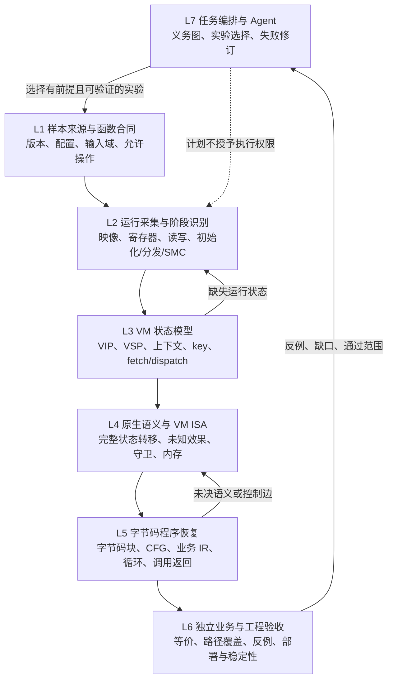

# 自动 VM 业务恢复框架与验收计划

客体实验的强制前置流程见 [每次实验必做的启动与就绪检查](GUEST_DEBUG.md#每次实验必做的启动与就绪检查)：先启动/恢复实际 VMX，确认运行、桌面解锁、服务认证和本次目标 SHA 目录就绪，再开始恢复。环境缺件记为 environment-not-ready；文件 profile 的固定 false 标记不代替实时连接判断。

L3 新增[VM 上下文候选与阶段边界](VM_CONTEXT_MODEL.md)：从逐字节绑定的 recurrence 与 handler 闭包自动归纳 fetch/VIP、dispatch base、opcode carrier、handler target carrier 和 VSP 候选，并生成保留 partial/unknown 的观测 handler 字典。单运行只产出候选；初始化、fixup 与业务阶段在 epoch、合同和独立输入缺失时保持 unknown。

L3新增[取流到间接控制依赖](VM_FETCH_FLOW.md)：从已封存候选自动选择完整连续段，复核字节映射并连接原始完整状态 SSA；单纯邻近读取、输入被消去、普通跳转表及语义非常量性必须分别判断。该阶段仍没有VM角色/阶段/完整业务证书。

P1/L3现有[录制寻址与角色假设](VM_ADDRESS_ROLES.md)：全窗口验证后自动采样，绑定解码表达式与原观察；VIP/VSP角色、取流到分发数据依赖和完整VM模型仍未证明。

P1首步已接入[原生录制统一观察层](VM_OBSERVATIONS.md)：按摘要导入已有运行状态，核验连续性并保存带来源的分页观察。阶段分类、真实模块/内存epoch、字节码角色和自动VM模型仍待实现；不是P1整阶段或业务验收通过。

本文调整无限五代的研发主线：围绕一个有来源、可复现的函数恢复任务，建立“采集运行证据 → 推导 VM 模型 → 恢复字节码程序 → 独立验证业务 → 用失败改进能力”的闭环。局部处理器研究作为这个闭环的组件和回归材料，不再以处理器数量或证明查询数量安排主线。

本文件是整体设计与阶段验收约定。当前能力快照依据 2026-10-17 核对的源码文档、`current-state.json` 和 C208 checkpoint；后续能力状态应从具体任务及有效证据计算，不能将本文中的计划视为已经实现。

## 目标与完成条件

工作对象是明确版本、保护配置和函数合同下的受保护程序。目标同时包括 VMP 3.8、其他 VMP 配置以及多保护器，分别记录结果；不得将一个版本或一种配置的成功外推为所有加固的通解。

一个函数合同至少说明入口、正常返回条件、输入域、输出、可观察内存副作用和环境假设。存在异常、系统调用、外部函数或多线程影响时，必须明确纳入合同、给出模型，或保留未验证项。只恢复 RAX 不能代替存在其他副作用时的完整业务。

该项任务完成需要同时成立：

1. 原文件、生产器版本、保护配置及允许的操作范围有可复核来源。
2. 运行证据真实到达合同规定的返回点；记录缺口、自修改、重定位及环境观察均有明确范围。
3. VM 状态、取指、分发、处理器语义和具体字节码程序之间具有可追溯关系。
4. 完整业务输出及副作用与独立参考一致，输入域与路径覆盖有相应证据；失败、反例和 unknown 不被省略。
5. 相同冻结版本在重复运行、安装部署和配置模型中可复现；自主验收不依靠人工逐段提供地址与语义答案。

“完整函数合同通过”和“整个二进制所有行为通过”是不同声明。现有工具的 `wholeBinaryVerified=false` 保持原义；不能用单函数证据升级整个程序结论。

## 七层架构



L7 管理任务，不取代 L6 的验证。模型可以提出假设、选择工具和解释错误；阶段完成必须有独立核验的证据。Skill 用于约束推理与操作流程，不能把模型的文字声明变成等价证明。

用户提供的 VMPBypass 最值得转化为产品的方法位于 L2、L3、L5：先区分初始化与真实解释阶段，推导 VM 上下文和取指分发，再恢复具体程序。参考项目的地址、槽偏移、fetch 特征和案例结论不能作为五代的新样本答案。现有材料的范围见 [VM 模型研究](VM_MODEL_RESEARCH.md)。

## 层间接口与证据产物

以下是接口必须携带的信息约定，不是本轮已经发布的 API schema。地址采用精确的地址空间标识与十六进制值；数据和报告通过不可变摘要关联。

| 产物 | 必须携带的身份与内容 | 下游可据此作出的判断 |
| --- | --- | --- |
| Case 与函数合同 | 目标 SHA、来源、生产器/编译器、版本/build、配置 SHA、输入/输出合同、环境及允许操作 | 确定本次研究对象和声明边界 |
| 采集运行 | 目标/运行/线程/地址空间、模块加载 epoch、暂停序号、入口/返回、VM 配置及快照引用（适用时） | 判断观察是否来自同一次运行和一致暂停 |
| 有序采集事件 | 序号、指令位置、原指令字节、完整寄存器/flags、实际读写字节、缺口和丢失状态 | 重建数据依赖及实际观察范围 |
| 阶段与代码版本 | `phase` 候选及依据、初始化/fixup/dispatch/SMC、代码和内存 epoch、写入来源 | 防止将磁盘数据、初始化表和运行期字节码混用 |
| VM 模型候选 | VM 实例、VIP/VSP/context/key 角色表达式、作用时点、取指/分发表达式、别名及环境假设、反证 | 选择下一项能区分候选的实验 |
| 语义摘要 | 原字节与解码/语义摘要、全部输入/输出状态、完整内存及有序写、flags、守卫与互补出口 | 在已验证前提下组合状态转移 |
| 字节码程序 | 字节块 SHA、采集位置与时序、解码/key 转移、指令与 ISA 关系、CFG/IR、未决边 | 解释具体被保护函数，而非只聚类 handler |
| 验收包 | 参考合同、证据依赖、验证器版本、查询与结果、反例、覆盖范围、失败与未知、部署 pins | 计算各轴状态及允许对外声明 |

“原入口 RSI”“当前 VM VIP 所在 RSI”“某次上下文加载得到的 RSI 值”必须是不同角色和时点。寄存器名称相同不能自动继承语义。运行期解密字节码须绑定观察时刻及其代码/内存 epoch；一次读到明文不能证明未来读取仍是这些字节。

代码被写入后，应使依赖旧代码的解码、模型和证明标为 stale；只有核对新的字节及来源后才能重新使用。已有内存 DAG 的数据语义不自动证明 CPU 取指、页故障、并发写入和 SMC 一致性。

磁盘、加载映像、初始化后内存和执行时读到的字节分别保存；不可读页为空洞，不补零。跨运行、线程或地址空间的状态不能拼接成一条连续执行轨迹。

## 当前能力矩阵

`existing` 表示已有接口和特定证据；`research` 表示仅有局部证明、候选或固定案例；`missing` 表示所需闭环尚未形成。每项仍须阅读其实际作用范围。

| 能力 | 状态 | 当前可复用部分 | 尚未完成的目标 |
| --- | --- | --- | --- |
| Case、来源与样本摘要 | existing / research | 现代样本清单、生成配置、编译和生产器证据 | 统一可调度的函数合同、义务图与当前状态视图 |
| 精确 VMP 3.8 样本准入 | missing | 已审查版本线索与公开研究 | 可核验的 3.8 生产器/目标/配置及独立业务参考；本地审查归档实际为 3.7.3.1628 |
| VMP 3.11 Demo 自产回归 | existing | 明确版本/build、自产控制与保护配置、组件及局部语义回归 | 不外推 3.8、最大强度或同组未通过配置 |
| 宿主/VMCI 客体调试 | existing | 已审批的自产目标调试、录制、映像和清理协议 | 不等同于客体外整机/内核执行观察 |
| 整机采集后端 | missing / research | 已有方法审查，VMware 实验环境 | 固定后端、客体支持、地址空间识别、事件到指令映射及成本实测 |
| 阶段识别与动态字节码 | research | 同暂停映像、固定案例的入口/初始化/分发研究 | 自动区分初始化/fixup/业务执行，并连续绑定运行期字节码及 SMC epoch |
| 有界路径发现 | existing | 静态候选地址链，随后由 Java project 重验语义 | 候选不构成可达性、自动 ISA 或完整 VM 模型 |
| 完整普通状态投影/组合 | existing | 16 GPR、字节内存、有序写、guard/补出口及有限未知效果 | 不提供完整 CPU/OS/故障/SMC 证明；公开接口不接收外部语义证书 |
| 取流到控制及重复路径核验 | existing / research | 自动字节路径/索引候选、普通IR变化见证、原录制首4尾4末态与有序STORE检查 | 普通表/缓冲区仍有歧义；未证明VM角色、阶段、epoch、跨实例和业务；不能将重复初始化过程当业务恢复 |
| 录制分发主体自动恢复 | existing / research | 已提交重复路径自动选主体并进行Java完整普通状态投影；独立区分相对控制PC、运行期数据与未知保存标志 | 固定旧3.11录制的普通状态一致性；未知GPR/STORE、另一条件续程、VM角色/ISA/具体程序和完整业务仍待解决 |
| 观察组合覆盖与选样 | existing / research | 描述符全扫描、最多256组合清单、首现每页8路径；默认首4尾4保持 | 组合不是opcode或独立输入；来源未观察、预算遗漏和首个实例失败保留，未证明全部处理器或业务 |
| VM 状态与 ISA 推导 | research | 固定 3.11 handler、槽位与局部连接证书 | 样本驱动的角色推导、独立语义恢复和模型修订流程 |
| 具体字节码程序/业务 IR | research / missing | 离线轨迹恢复、若干函数表达式和路径验证 | 以 VM 模型解释完整程序，处理复杂循环、调用、未决边与副作用 |
| Ultra 八轮业务恢复 | research | 局部状态证书；另一次原生运行观察到正确返回 | 100000 指令记录仍为未返回前缀；完整输入/路径业务未通过 |
| Enigma 八轮业务恢复 | research | 记录输出与独立全宽参考等价 | 640 原窗口守卫及 320 反例前缀守卫未解决；替代路径未完整返回 |
| DSH 自主研究 | existing / research | 原生续轮机制、真实工具调用、有限参数自修复 | 不提供地址/ISA 预答案的完整函数自主恢复验收 |
| 安装、模型和工程回归 | existing | 冻结源码/安装 pins、原生协议/清理、真实配置模型验收 | 新框架和每项新能力仍需自身部署与自主验收 |

既有 C208 证据证明 3 层局部组合、槽位来源及明确条件下的连接。它也明确保留 `businessAccepted=false`、`nativeReachabilityProved=false`，并区分 22 项新查询与 6 项旧查询复用。自动取流、普通IR见证和重复路径核验见 [取流流程](VM_FETCH_FLOW.md)，也各自保留角色、阶段和完整业务的未决项。因此不能用查询数或重复路径数估计距离“攻克 3.8”的百分比。

证据入口为 [现代保护清单](MODERN_PROTECTION_CORPUS.md)、[VMP 3.8 研究](VMP38_RESEARCH.md)、[轨迹恢复](TRACE_RECOVERY.md)、[状态投影](STATE_PROJECTION.md)、[状态组合](STATE_COMPOSITION.md)、[客体调试](GUEST_DEBUG.md) 和 [槽 208 条件连接](CONTEXT208_JOIN.md)。

## 保护配置与证据矩阵

验收行身份采用“保护器 + 精确版本/build + 架构 + 生产器 SHA + 配置 SHA + 目标 SHA + 函数合同”。配置不同、VM 实例不同、随机输出不同分别记录；相同 SHA 的重复引用不增加独立样本数量。

配置轴至少涵盖：虚拟化/变异/组合模式、实际可用的强度选项、VM 类型、业务形态、输入域、调用方式、OS/CPU/运行后端与采集方式。Demo 缺失的功能、被转换的 VM 类型、无法生成或不可用的样本必须单列，不能计为已测试。

每行分别维护来源、采集、VM 模型、ISA、字节码程序、业务、稳定性、自主性八个验收轴。状态采用 missing/candidate/observed/verified/failed/unknown/blocked-external/stale，并保存：

- 本状态的具体 scope、前提和环境假设。
- 不可变证据引用、验证器版本和最近核验时间。
- 未完成义务、反例、失败分类及可区分候选的下一实验。
- 依赖关系；上游字节、版本、合同或模型变化时如何失效。

阶段状态不可由调用者自报升级。结构检查、观察吻合、局部等价、业务覆盖和自主操作是不同证据，不能合并成一个绿色标记。

## 两份参考带来的方向调整

VMPBypass 提供“VM 状态/解释器与具体程序分开恢复”的方法；apk-reverse-main 补充能力闭包、基线对照和失败路由。具体实现审查见[参考项目吸收记录](REVERSE_WORKFLOW_SOURCE_REVIEW.md)。五代采用以下约定，外部说明中声称的成功不自动进入本项目能力矩阵：

1. 每个实验展开工具能力、输入产物、版本/后端和权限的依赖闭包。脚本存在、依赖存在、启动成功、目标能力实测分别记录。未探测的能力为 unknown，不能由 PATH 或目录存在推断已可用。
2. 保留同流程基线、正例对照、单一变更、预期区分结果和反证账本。裸假设修订号、新的失败文字或同字节换引用 ID 都不算新证据；相同失败至少两次触发重新分类，不结束总目标。
3. 外层控制流平坦化、初始化循环、真实 VM 分发器分别建候选。用字节码来源及上下文读写检验，而非只按块频率判断；嵌套 VM 保留各实例及进入/退出栈，不能把地址重复直接当同一解释器状态。
4. 从全部 STORE 的地址和值、控制、输入/输出和未知效果反向切片。字节码解密状态与业务状态分别追踪；HOSTCALL/ABI、异常与环境影响形成独立义务，不能用一个输出算式替代整个处理器。
5. Skill 效果通过相同冻结条件下的实际任务对照测量。with/without-skill、模型、提示与人工干预均记录；脚本单元测试、作者设备日志和未运行的 eval skeleton 不替代 DSH 自主验收。

## 失败驱动的反馈闭环

| 失败类别 | 下一步应解决的问题 | 保留的边界 |
| --- | --- | --- |
| 来源/版本未准入 | 补生产器、配置、目标及来源核验 | 其他版本结果保持隔离 |
| 轨迹前缀未返回 | 定位停在哪个阶段/循环，选择语义边界与有证据的摘要策略 | 不将预算耗尽、退出 0 或单次正确 RAX 当返回证明 |
| 活未知 flags/不支持语义 | 生成最小复现，补独立指令语义与负例 | 不注入初始 flags，不删原指令 |
| 缺失内存/未知别名 | 补同 epoch 读写证据，或保留自由内存与相关义务 | 不补零、不跨未知 STORE 读取旧值 |
| SMC/代码 epoch 不符 | 使旧依赖失效，重新捕获并翻译实际代码 | 不拿磁盘相同代替运行代码相同 |
| 未决守卫/未覆盖路径 | 使用真实 SAT witness 选择补采路径，保留完整原约束 | 反例不自动授予执行权限；输出等价不等于路径覆盖 |
| 查询 unknown/超时/预算耗尽 | 共享 DAG、去重、已证明的局部摘要或明确归纳 | 不提高预算换通过，不将 unknown 当 UNSAT |
| 清理/所有权不明 | 保留占用，走原服务与会话的恢复协议 | 不因断管、stop/no-task 或普通 cleanedUp 释放 |
| 模型错误声明/参数错误 | 核对实际调用与报告，修复计划并记录原错误 | 模型说明和人工编辑不能追认缺失的原生/业务验收 |

每个失败记录需要绑定失败义务、归一化指纹、假设修订、输入证据、尝试的变更、实际结果和下一项可证伪实验。同一失败、同一假设反复出现而无新证据时，调度器应转入诊断或提出不同实验，不能重复运行同一批案例冒充进展。

最小复现只是新诊断产物，完整原轨迹、失败报告和超时查询继续保存。修复后的通过另建证据，不覆盖旧失败。

## P0—P5 里程碑

| 阶段 | 主交付物 | 必须通过的阶段验收 |
| --- | --- | --- |
| P0 任务与证据底座 | 独立 case、函数合同、义务依赖、纯 planner、只读 CLI；当前状态从有效证据导出 | 依赖/预算/操作权限拒绝路径；失败与 unknown 不升级；陈旧证据失效；相同输入生成可核对计划；只规划不执行 |
| P1 采集与阶段接口 | 统一运行身份、事件、阶段、代码/内存 epoch 和字节码读取来源 | 自产程序的初始化、代码变化、实际分发和返回可区分；缺口/跨运行/错误 epoch 被拒绝；原审批和清理完整 |
| P2 自动 VM 状态模型 | VIP/VSP/context/key、fetch/dispatch 候选及证伪实验 | 使用未提供槽位答案的自有 fixture，推导角色并用独立状态核验；错误候选、别名和角色变化有反例 |
| P3 ISA 与程序恢复 | 完整语义摘要、证明义务、字节码 CFG/IR、组合及循环/调用边界 | 不预置案例 opcode 答案，局部等价与全状态副作用独立核验；未决语义/路径完整保留；已有正负回归通过 |
| P4 完整函数业务验收 | 返回证据、输出/内存等价、路径覆盖、独立参考与反例回路 | 冻结配置下完整函数合同通过；独立输入与路径、环境前提、异常和外部影响有相应证据；失败配置不混入通过 |
| P5 自主性与稳定部署 | DSH 端到端自主流程、多版本配置回归、重复冷启动与故障恢复 | 不给逐段地址/语义预答案；真实配置模型自主修复并完成任务；安装 pins、权限门、取消/清理、重复运行和成本可复现 |

P0 的实现范围是独立 case、纯 planner、只读 CLI 和 `ig5_recovery recovery` 规划入口。它尚未连接自动执行或独立阶段/业务验收器；具体 schema、命令及代码入口以实现和测试为准。P0 能组织待验证义务，不能自行认证调用者提交的报告，也不能把 caller-claim、规划结果或框架文档提升为业务通过。

后续接入 DSH 必须显式使用真实 agent 上下文及已有工具/Goal 驱动，核对实际调用事件。planner 的下一步建议不得直接触发执行、模拟、调试、写入或远程操作；有这些效果的动作仍进入现有审批和所有权流程。

## 单函数无预答案自主验收

固定测试只提供合法自有样本及来源、函数入口/合同、允许操作和总预算。不给 handler 地址数组、opcode 对照、VIP/VSP 所在寄存器、预先求好的槽位映射或期望恢复公式。参考源码/业务 oracle 与恢复侧分离，最后由独立验收侧使用。

模型需要自行提出 VM/阶段候选，选择有界采集或静态实验，建立语义与程序，解释失败，再依据反例修改计划。记录实际模型、skill、工具参数、产物、假设修订、人工提示及验证器结论。人工介入可以继续推进工程，但必须计入该次验收；不能将介入后的成功登记为零提示自主成功。

首先用可掌握全部来源的 fixture 验证这个闭环，再在同一合同下分别验收 3.11 和准入后的精确 3.8。已给定路径的模型复验继续作为工具回归，不替代本项自主验收。

## 来源与后端车道并行推进

精确 3.8 来源车道持续查找可公开核验的生产器版本、保护配置、合法学习样本及参考程序。仓库标题、作者成绩、论坛日期和“3.x”标签只能作为线索；准入缺件保留 unknown。3.11 自产材料用于通用框架研发和回归，不能补填 3.8 的来源或业务结果。

现有用户态/客体调试用于验证当前采集接口。客体外整机/内核观察后端作为独立可插拔研究项，需固定构建、系统支持、快照/设备状态、地址空间归属、记录到指令状态的映射和性能证据。已有 VMware 或系统事件回放不能直接称为完整指令轨迹。

新工具的来源、许可、依赖和行为应先审查；只有与目标能力对应的实际验收通过后才进入能力矩阵。不执行未准入的外部挑战，不恢复隔离文件，不通过改名、复制或安全设置变化绕过现有阻断。

## 效率指标与下一步选择

每轮优先选择能解除完整函数关键依赖、区分竞争模型或产生可复用能力的实验。局部证书只有在解除具体义务或形成通用回归时才算该任务的主线进展。

| 指标 | 计算与解释 |
| --- | --- |
| 完整函数合同通过数 | 按版本/配置/目标/合同去重；单次输出、局部表达式或生成样本数不计 |
| 义务变化 | 新增、解决、失效和未决分别报告；包含假设及未知路径，不只统计减少量 |
| 关键路径变化 | 本轮解除哪个采集/模型/语义/覆盖阻塞，下一实验依赖是否已具备 |
| 人工提示成本 | 地址、槽位、语义、预期答案及运行干预分开计数；guided replay 单列 |
| 自主修复 | 实际失败后形成不同可验证实验并获证据的比例；重复调用不计修复 |
| 覆盖与迁移 | 新输入/路径/配置及独立样本，而非同批数值状态或旧证明重复运行 |
| 稳定性 | 重复冷启动/部署/取消/断连恢复的实际结果和残留占用；未知不能当成功 |
| 成本 | 冻结硬件/构建/输入下的采集时长、恢复时长、峰值内存、数据量、求解和模型成本 |

性能比较须记录负载、测量方法和重复次数。查询缓存命中、复用旧证书、相同数值批次以及徽章次数各自报告，不能累计为新增 CPU 或业务覆盖。

## 权限、预算与许可保持

本框架不改变 Core8/Full40、13 个公共审批门、原运行时/供体 pins、许可证或安全设置。持续研究使用宿主原生 Goal，任务文件本身不是自动续轮证明。

project/compose 继续遵守各自指令、内存访问、节点/引用/深度、报告和共享两槽/进程预算；离线 trace 继续默认 50000、显式最多 100000 指令及原输入、SMT、期限限制。原生录制保持 512 步/1 MiB/40 秒窗口，映像保持 8 MiB 上限。P0 新计划产物也须有自身明确边界，不能借调度拆分绕过原请求限额或所有权。

清理仍需对应 nonce 的原始 ACK 与实际协议根退出；客体远程操作保留原 HMAC、root/Job 和 close_ack 契约。断开连接和观察超时不证明目标停止。执行审批与任务授权保持独立于 planner 的候选动作。

现有源码许可仍为 CC-BY-NC-SA 4.0，第三方保留各自许可；本文件不把项目宣布为 OSI 开源许可，也不改分发规则。外部保护器、许可文件、私有客体配对材料和未授权二进制不进入插件发行包。

## 代码入口

P0 首版代码已经存在：

- `source/vm_recovery_case.js`：严格 `ig5-vm-recovery-case-v1` 合同、九阶段依赖、失败分类、case 与输入快照摘要。
- `source/vm_recovery_plan.js`：纯规划器。派生当前工作视图、失效原因、依赖闭包、失败反馈及下一动作；不执行工具、不接受 caller 的 passed/verified 状态。
- `source/vm_recovery_io.js`：有界文件核验与完整输入快照，CLI 与宿主使用同一读取路径。
- `source/vm_recovery_profile.js`：已有 `ig5_recovery` 内的独立只读入口(原 `ig5_profile.recovery`)、原始 case 摘要前置核验、不可变完整报告和有范围标记的模型预览。
- `scripts/plan_vm_recovery.mjs`：只读文件入口。稳定读取 case 和显式引用，逐项重验字节身份后调用规划器；不写任务文件、不访问网络、不启动子进程或目标。
- `scripts/fixtures/vm_recovery_case.example.json`：尚未准入的 3.8 空白任务，未知字段保持 null；不含外部二进制或预置 ISA 答案。
- `scripts/test_vm_recovery_plan.mjs`：独立的合同、陈旧/替换证据、依赖、失败路由、重复与文件读取回归。
- `scripts/test_vm_recovery_profile.mjs`：宿主/IO/取消/保存/摘要/权限隔离回归；真实 SDK 注册和输出验证另由 `scripts/test_host_sdk.mjs` 检查。

在仓库根使用 PowerShell 和可用的 Node：

```powershell
node scripts/plan_vm_recovery.mjs (Resolve-Path scripts/fixtures/vm_recovery_case.example.json).Path
node --test scripts/test_vm_recovery_plan.mjs
```

DSH 模型使用已有 Core8 入口，不需新增工具或切换 Full：

```json
{"recovery":{"case_ref":{"path":"C:\\research\\case.json","sha256":"<原文件字节的64位小写SHA-256>"}}}
```

参数须单独调用，不与 target/engine/toolset/workspace/history/guest_debug 混用。SHA 必填，核对失败在 JSON 解析和引用读取之前拒绝；取消在输入读取前、引用间和报告提交前检查。此调用不打开目标/数据库、不启动分析或调试进程、不变更 Goal 或执行授权。报告最多 4 MiB，保存完整 caseSnapshot、引用核验和全部依赖；预览的 reportPath/reportSha256 是本次报告的精确引用，不能以旧路径代替。

Case 明确绑定 `caseId/objective/scope`。scope 包含目标、生产器、配置、完整函数合同的 SHA、架构、实际版本/build、函数入口、代码 epoch 和模型修订。`references` 保存 `id/kind/path/bytes/sha256`；文件路径为显式绝对本地路径，拒绝 `..`、UNC 与检查到的链接祖先。读取期间重验普通文件身份和摘要，路径检查不构成任意文件系统竞争下的安全边界。

事件包含 `id/stage/state/bindingSha256/inputBindingSha256/inputs/references/hypothesisRevision/failure/note`。`bindingSha256` 使用 `recoveryBinding(case)`；`inputBindingSha256` 使用 `recoveryObservationBinding(case,event)`，绑定当时引用内容和前置事件摘要。依赖只指向更早的直接前置阶段；旧引用内容或前置记录变化时旧事件失效。工作状态仅允许 partial/candidate/failed/unknown，始终为调用者观察；后续持久写入还需 CAS 与追加协议，当前 CLI 不提供写入。

规划返回 `stages/evaluatedEvents/blockedRequirements/nextActions/deferredActions/engineeringActions`。输入产物存在只标 `declared-reference-present`，所有能力探测仍为 `not-probed`；文件 SHA 相符只证明字节身份。清理事件即使过期仍保守保留观察持有，但 `executionAuthority=not-inspected`；没有持有事件也不表示真实进程已停止。真实执行/清理始终由原持久 owner 与公共工具协议决定。

Case 最多 256 KiB、128 个事件、64 个引用；每引用最多 8 MiB、声明引用合计最多 16 MiB。最多四项优先动作，其余明确列入 deferred；工程回归可在业务未完成时开展，最终 autonomy/deployment 门仍需完整业务与对应实际验收。原引擎/求解/采集预算保持独立。

通过 DSH 调用时 `integration.dshPlanningEntry=ig5_recovery.recovery`，纯 CLI 只报告自身没有调用宿主入口。`automaticExecution/stageVerifiers` 仍为 `not-connected`，所有阶段 `gateAccepted=false`，`completionAssessment` 始终未达成。规划入口的源码/SDK/部署/实际配置模型验收应分别记录；它们不能升级为自主业务恢复。下一主线是统一采集/阶段证据适配与自动 VM 角色推导，不再以增加更多固定 handler 案例替代。独立验证器接入后，才有资格根据真实证据推进阶段门。
